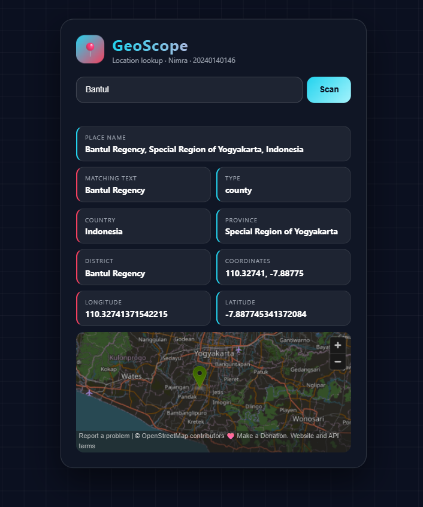

# 146_WeatherApi

Web Service Development assignment. An HTML page that searches for a location and shows its details using the MapTiler Geocoding API.

Name: Nimra
Student ID: 20240140146

## Data shown
- Place name
- Matching text
- Type
- Country
- Province
- District
- Coordinates, longitude, and latitude
- A map of the location

## How to run
1. Open `script.js` and put your MapTiler API key in `API_KEY`.
2. Open `index.html` in your browser.
3. Type a location and click Scan.

## Result

## GET response in the browser
